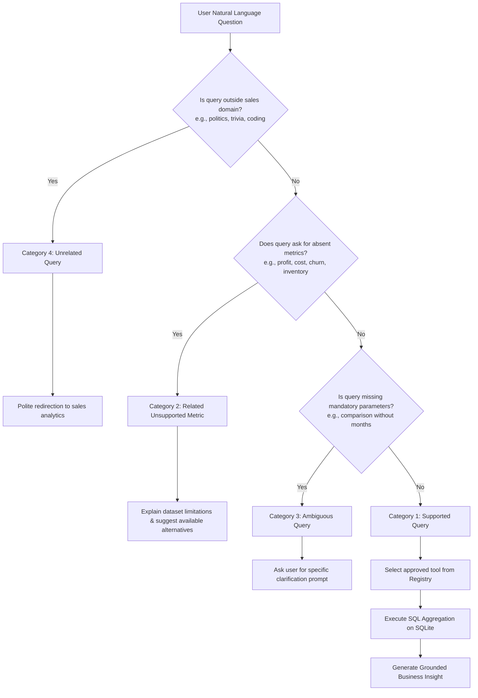
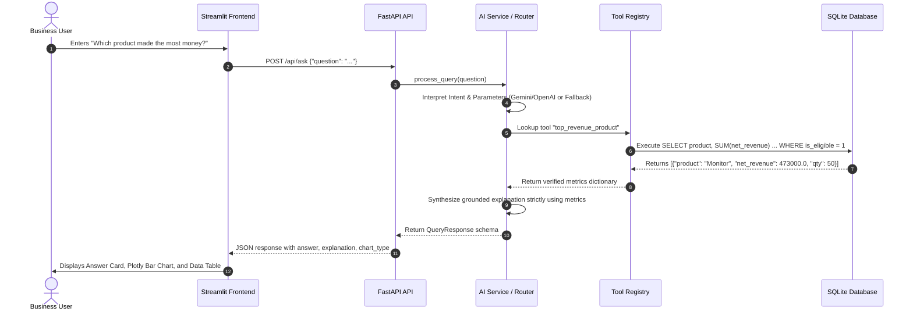
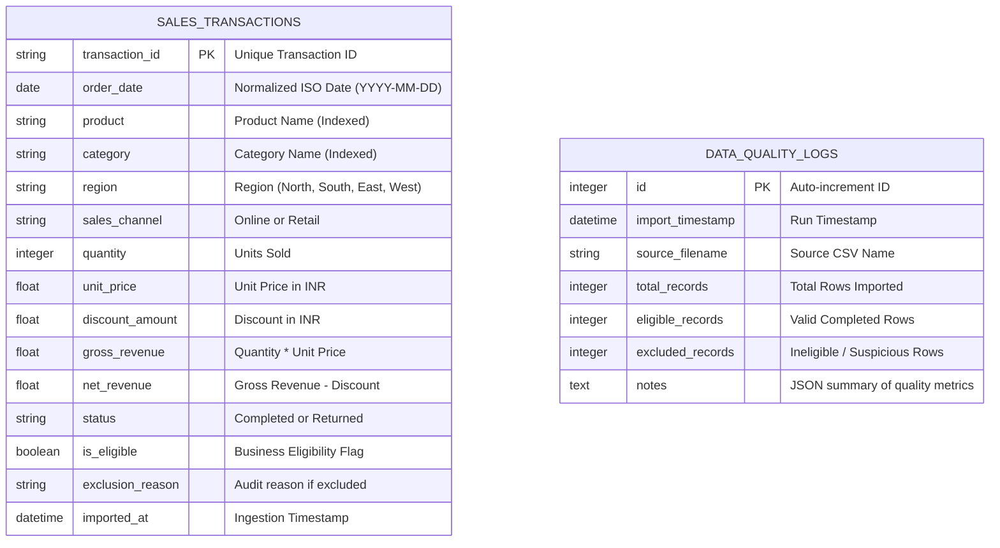
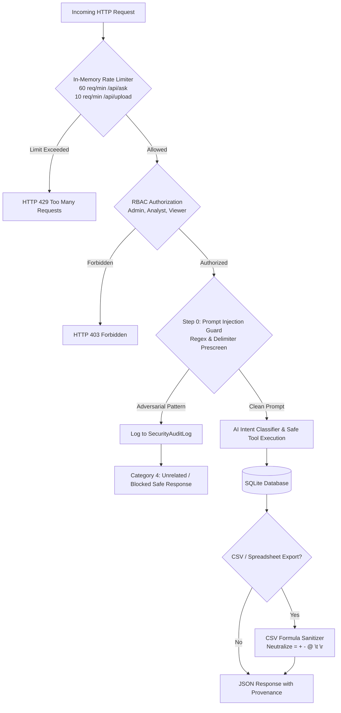

# Mini AI Business Intelligence Assistant – System Architecture

## 1. Executive Architecture Overview

The **Mini AI Business Intelligence Assistant** is built on a modern, decoupled three-tier architecture specifically engineered for reliable, deterministic analytics and safe Generative AI interactions:

1. **Presentation Layer (Streamlit & Plotly):** Responsive executive dashboards, natural-language conversational chat interface, dynamic interactive visualizations, and audit transparency reports.
2. **Application & Orchestration Layer (FastAPI & AI Router):** REST API endpoints, Pydantic data contracts, lightweight AI intent routing, safe tool allowlist execution, and grounded business insight synthesis.
3. **Data & Storage Layer (SQLite & SQLAlchemy):** Normalized relational transaction storage, indexed query paths, automated audit tracking, and idempotent ingestion pipelines.

```mermaid
graph TD
    User([Business User]) -->|Natural Language Question| UI[Streamlit Frontend Dashboard]
    UI -->|HTTP POST /api/ask| API[FastAPI Backend Engine]
    
    subgraph AI Orchestration Layer
        API --> IntentRouter{AI Intent & Tool Router}
        IntentRouter -->|With API Key| LLM[Google Gemini / OpenAI API]
        IntentRouter -->|No Key / On Error| RuleRouter[Deterministic Pattern Classifier]
        LLM -->|Validated JSON Schema| Intent[Structured Intent & Parameters]
        RuleRouter --> Intent
    end

    subgraph Tool Execution & Retrieval Layer (Vectorless RAG)
        Intent -->|Tool Name & Params| ToolRegistry[Approved Tool Registry]
        ToolRegistry -->|Safe Param Execution| SQLAnalytics[SQLAlchemy Analytics Engine]
        SQLAnalytics -->|Parameterized SQL Query| SQLite[(SQLite Database)]
        SQLite -->|Exact Numerical Aggregations| SQLAnalytics
    end

    subgraph Grounded Synthesis Layer
        SQLAnalytics -->|Verified Database Metrics| GroundedGenerator[Grounded Insight Synthesizer]
        GroundedGenerator -->|Deterministic / LLM Explanation| UnifiedResponse[Unified Query Response]
    end

    UnifiedResponse -->|JSON with Metrics, Text & Chart Specs| API
    API -->|Render Cards, Tables & Plotly Charts| UI
    UI -->|Interactive Visual & Business Insight| User
```

---

## 2. RAG and Vectorless Structured RAG

### Traditional RAG vs. Vectorless SQL RAG

In contemporary enterprise AI, **Retrieval-Augmented Generation (RAG)** refers to grounding large language models on external knowledge sources rather than relying solely on the model's pre-trained parametric memory.

| Dimension | Traditional Vector RAG | Vectorless SQL RAG (This Application) |
|---|---|---|
| **Data Nature** | Unstructured text documents (PDFs, wikis, articles) | Structured tabular records (transactions, quantities, prices) |
| **Indexing Method** | Dense vector embeddings generated via embedding models | Normalized relational schemas with B-tree primary keys and indexes |
| **Retrieval Engine** | Approximate Nearest Neighbors (ANN) in Vector DBs | Exact, deterministic SQL aggregations (`SUM`, `COUNT`, `AVG`, `GROUP BY`) |
| **Numerical Precision** | **Imprecise:** Vector similarity cannot perform arithmetic, sums, or groupings | **100% Deterministic:** Relational database calculates numbers to the penny |
| **Hallucination Risk** | High for arithmetic (LLMs frequently fabricate totals) | **Zero:** Numbers are retrieved directly from SQLite; LLM only explains |
| **Cost & Latency** | High (embedding compute, vector DB infrastructure) | Ultra-low (sub-millisecond SQLite queries, lightweight orchestration) |

### Why a Vector Database is Unnecessary for this Dataset
A vector database computes semantic distances between sentences. However, business questions such as:
- *"What is our total net sales revenue?"*
- *"Which product made the most money?"*
- *"Did sales increase in June compared with May?"*

require **mathematical aggregation**, **date filtering**, and **relational grouping** over tabular columns (`Quantity`, `Unit_price`, `Discount_amount`, `Status`). Vector embeddings cannot compute `Quantity * Unit_price - Discount`. Using SQL-based Vectorless RAG ensures complete mathematical fidelity, zero hallucinations, and instant execution.

---

## 3. Four-Category Question Taxonomy

The system classifies every incoming natural-language user query into an explicit 4-category taxonomy before triggering any database execution:



### Detailed Category Descriptions
1. **Category 1 – Supported Questions:** Mapped to one of 19 approved analytical tools in the registry (e.g., Total Revenue, Top Product, Monthly Trend, Top Region, Month-to-Month Comparison, Channel Split, Category Share).
2. **Category 2 – Related but Unsupported Questions:** Business queries addressing concepts the dataset cannot support because cost, inventory, customer identity, or marketing spend attributes are absent. The system explains the limitation and suggests available analyses.
3. **Category 3 – Ambiguous Questions:** Queries lacking required parameters (e.g., *"Compare revenue"*). The system halts execution and requests parameter clarification (e.g., *"Which two months would you like me to compare?"*).
4. **Category 4 – Unrelated Questions:** General trivia, politics, recipes, or non-business queries (e.g., *"Who is the Prime Minister of India?"*). The system politely redirects the user to sales intelligence.

---

## 4. AI Agent and Safe Tool-Calling Architecture

To ensure strict enterprise security and prevent model hallucinations, the assistant adheres to a **Controlled Tool-Calling Architecture**:



### Core Security Guarantees
- **No Unrestricted LLM SQL Generation:** The LLM is NEVER permitted to generate or execute arbitrary raw SQL queries.
- **Approved Tool Allowlist:** Execution is restricted to pre-registered, parameterized analytical functions.
- **Read-Only Data Access:** Assistant execution paths only perform `SELECT` queries on the database.
- **Zero Hallucinated Numbers:** All metrics (`metrics` dictionary) are calculated directly by SQLite; the LLM only generates narrative explanations grounded on those figures.

---

## 5. Database Schema & Data Quality Policy

### Relational Schema Design


### Documented Business Eligibility & Revenue Calculation Policy
- **Gross Revenue:** $\text{Quantity} \times \text{Unit Price}$
- **Net Revenue:** $\text{Gross Revenue} - \text{Discount Amount}$
- **Realized Sales Policy:** Primary sales KPIs are calculated strictly from **Eligible Completed** transactions:
  - $\text{Status} == \text{'Completed'}$ (transactions with status `'Returned'` such as `TXN0033` are excluded from realized revenue).
  - $\text{Quantity} > 0$ (transactions with zero or negative quantities like `TXN0034` are excluded).
  - $\text{Unit Price}$ must be numeric and $> 0$ (records with missing unit prices like `TXN0051` are excluded).
  - Discount amounts must be non-negative and $\le \text{Gross Revenue}$.
- **Audit Preservation:** Ineligible records are **never silently discarded or modified with fabricated zeros**. They are stored in SQLite with `is_eligible = False` and clear `exclusion_reason` strings for complete governance transparency.

---

## 6. AWS Cloud Deployment Architecture (Readiness Roadmap)

The application is designed following cloud-native twelve-factor principles, enabling straightforward adaptation to Amazon Web Services:

```mermaid
graph LR
    subgraph Client
        Browser[Streamlit Web App on AWS ECS / Amplify]
    end

    subgraph AWS Ingestion & API Gateway
        APIGW[Amazon API Gateway] --> Lambda[AWS Lambda (FastAPI Container / Mangum)]
    end

    subgraph AWS Storage & Database
        S3[(Amazon S3 Sales CSV Bucket)] --> Lambda
        Lambda --> RDS[(Amazon RDS PostgreSQL / Aurora Serverless)]
    end

    subgraph AWS AI & Conversational Services
        APIGW -.-> Lex[Amazon Lex Conversational Bot]
        Lambda -.-> Bedrock[Amazon Bedrock / SageMaker JumpStart LLMs]
    end

    Browser --> APIGW
```

1. **Amazon S3:** Replaces local `data/sales.csv` with automated S3 event notifications triggering ingestion on file upload.
2. **AWS Lambda + Mangum:** Packages the FastAPI backend as a serverless container image, eliminating idle server costs.
3. **Amazon RDS / Aurora Serverless:** Upgrades SQLite to managed PostgreSQL for horizontal scalability, read replicas, and VPC security.
4. **Amazon Bedrock / SageMaker:** Enables private enterprise LLMs (Claude 3.5 Sonnet, Llama 3, Amazon Titan) inside private AWS subnets.
5. **Amazon Lex:** Provides native omnichannel conversational bots (voice and chat) integrating directly with the backend tool router.

---

## 7. Security Hardening & AI Guardrails (Enhancement Package A)

Enterprise Generative AI deployments require multi-layered defensive controls:



1. **Step 0 Prompt Injection Pre-Screen:** Evaluates input queries against compiled regular expressions targeting prompt leakage, role elevation (`DAN mode`, `developer override mode`, `grant root admin`), delimiter hijacking (```system, ```admin), and jailbreak framing. Violations are short-circuited before any LLM or DB invocation, returning Category 4 (`Security Guardrail Violation`) and auditing the incident.
2. **Thread-Safe In-Memory Sliding-Window Rate Limiting:** Enforces fine-grained per-IP request throttling using thread-safe sliding deque windows (`InMemoryRateLimiter`). Scoped per worker process (no external Redis dependency required). Throttles `/api/ask` (60 req/min) and `/api/upload` (10 req/min).
3. **CSV Formula Injection Sanitization:** Spreadsheet applications (Excel, Google Sheets) execute cells beginning with `=`, `+`, `-`, `@`, `\t`, or `\r` as dynamic executable macros. The exporter prepends a single apostrophe (`'`) to cell strings during export generation while strictly preserving the pristine raw records in the SQLite database.
4. **Security Audit Logging:** All security-relevant events (authentication attempts, prompt injection rejections, rate-limit trips, dataset resets, and API key modifications) are persisted to the `security_audit_logs` table with timestamps, IP address, user role, and audit details. Exposed via `GET /api/security/audit-logs` (Admin only).

---

## 8. Advanced Analytics Engine (Enhancement Package B)

Extends deterministic analytics with four specialized algorithms:

1. **Statistical Anomaly Detection (IQR & Z-Score):**
   - Employs Interquartile Range ($Q_1 - 1.5 \times \text{IQR}$, $Q_3 + 1.5 \times \text{IQR}$) and Z-score thresholding ($|Z| \ge 2.5$) on eligible transaction net revenues.
   - **Crucial Governance Distinction:** Cleanly separates legitimate statistical transaction outliers (e.g., valid high-value enterprise bulk purchases) from confirmed data-quality policy errors (e.g., negative quantities or missing prices).
2. **Pareto 80/20 Revenue Concentration:**
   - Evaluates cumulative product net revenue contributions to determine the "vital few" driving 80% of sales.
   - **Explicit Denominator Guarantee:** State the exact denominator ($\text{Total Audited Eligible Net Revenue} = \text{₹1,439,200.00}$) to avoid ambiguous or distorted percentage representations.
3. **What-If Revenue Simulation:**
   - Evaluates prospective financial impacts of price variations ($\Delta P\%$), volume adjustments ($\Delta Q\%$), and discount modifications ($\Delta D\%$).
   - **Methodological Boundary:** Explicitly simulates revenue deltas without fabricating product costs or profit margins, as the current enterprise dataset does not contain cost data.
4. **Sales Target & Quota Pacing:**
   - Compares configured revenue targets against empirical sales data. Calculates attainment percentage, daily run-rate velocity, and projected period-end revenue against required run-rates.

---

## 9. Data Intelligence & Provenance (Enhancement Package C)

1. **Multi-Dimensional Data Quality Index (DQI):**
   - Synthesizes a composite 0–100 quality score across five standardized data governance dimensions:
     - **Completeness (25% weight):** Assesses null or missing fields in mandatory columns.
     - **Validity (25% weight):** Validates business constraints (e.g., unit price $> 0$, quantity $> 0$, valid status enum).
     - **Consistency (20% weight):** Verifies arithmetic integrity ($\text{Net Revenue} == \text{Gross Revenue} - \text{Discount}$).
     - **Uniqueness (15% weight):** Verifies absence of duplicated transaction identifiers.
     - **Timeliness (15% weight):** Confirms order dates conform to operating period bounds without future dates.
   - Categorizes dataset into governance grades: **Grade A+** ($\ge 95\%$), **Grade A** ($\ge 90\%$), **Grade B** ($\ge 80\%$), **Grade C** ($\ge 70\%$), or **Grade D** ($< 70\%$).
2. **Automated Ingestion Column Profiling:** Profiles uploaded CSVs during ingestion, recording inferred data types, populated/null counts, unique cardinality, and value distribution bounds.
3. **Source Provenance Metadata:** Every conversational AI query response includes an explicit `provenance` dictionary identifying the executed tool operation, target database entity, eligible row count used, excluded rows omitted, applied filter parameters, and deterministic SQLite ORM calculation guarantee. Raw SQL strings are never exposed to ordinary users.

---

## 10. Dashboard & AI Evaluation (Enhancement Package D)

1. **Interactive Multi-Dimensional Filtering:** Executive dashboard features dynamic filtering across Region (North, South, East, West), Channel (Online, Retail), Category (Electronics, Furniture), and Order Date range with instant KPI updates.
2. **Expandable Provenance Cards:** Streamlit assistant renders interactive provenance disclosure cards beneath AI answers displaying execution engine, row counts, and zero-hallucination verification guarantees.
3. **Adversarial & Numerical Grounding Evaluation:** Automated test suite tests prompt injection payloads and compares assistant calculations against SQLite database ground truth, verifying a 0.00% numerical hallucination rate across all analytical metrics.

