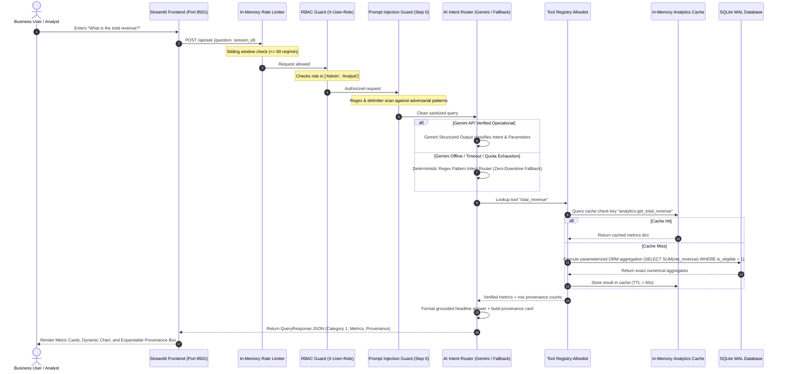
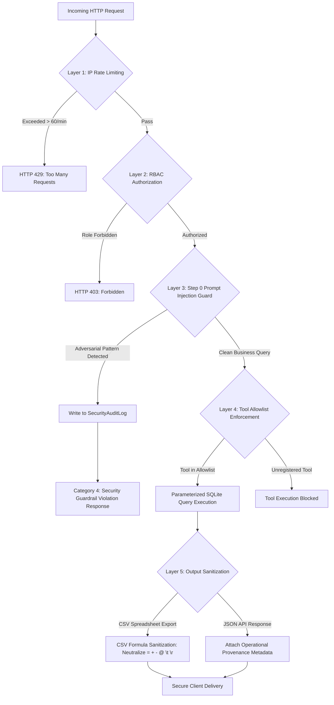
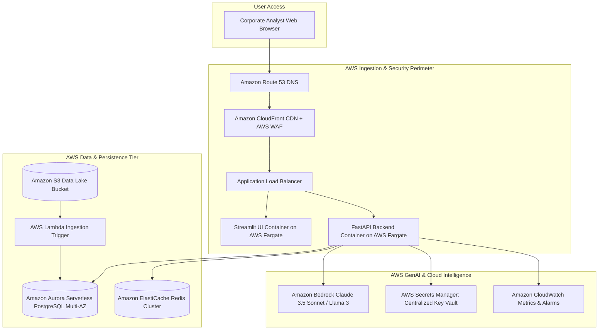

# Architecture & Data-Flow Diagrams – Mini AI BI Assistant

This document contains comprehensive visual architecture and data-flow diagrams illustrating the system's operational architecture, defensive security perimeter, analytics pipelines, and cloud migration path.

---

## 1. End-to-End Conversational Query & Grounding Flow



---

## 2. Multi-Layer Security & Defensive Perimeter (Package A)



---

## 3. Atomic CSV Ingestion, Profiling & Cache Invalidation (Package C)

```mermaid
flowchart TD
    Upload[Admin uploads Sales CSV] --> Rate[Upload Rate Limiter: <= 10/min]
    Rate --> SaveTemp[Save file to isolated scratch/ directory]
    SaveTemp --> Profile[Automated Column Profiling: Inferred Types, Nulls, Card, Bounds]
    Profile --> QualityCheck[Compute Multi-Dimensional Data Quality Index (DQI)]
    
    subgraph DQI 5-Dimension Evaluation
        QualityCheck --> D1[Completeness: 25%]
        QualityCheck --> D2[Validity: 25%]
        QualityCheck --> D3[Consistency: 20%]
        QualityCheck --> D4[Uniqueness: 15%]
        QualityCheck --> D5[Timeliness: 15%]
    end

    QualityCheck --> StageDB[Stage Records in Pending SQLite Transaction]
    
    alt Schema or Critical Validation Error
        StageDB --> Rollback[Atomic Rollback: Existing Dataset Completely Preserved]
        Rollback --> ErrorResponse[HTTP 422: Ingestion Rejected]
    else Validation Successful
        StageDB --> Commit[Commit Transaction: Sync to sales_transactions table]
        Commit --> AuditLog[Write Import Lineage to data_quality_logs]
        AuditLog --> Invalidate[Atomic Analytics Cache Invalidation: Flush analytics_cache]
        Invalidate --> SuccessResponse[HTTP 200: Successfully Synced Dataset]
    end
```

---

## 4. Advanced Analytics & Quota Pacing Architecture (Package B)

```mermaid
graph LR
    subgraph Input Dataset
        DB[(Audited SQLite Transactions)]
    end

    subgraph Package B Analytical Engines
        DB --> Anom[Anomaly Detection Engine]
        DB --> Pareto[Pareto 80/20 Engine]
        DB --> WhatIf[What-If Simulation Engine]
        DB --> Quota[Sales Target Pacing Engine]
    end

    subgraph Analytical Outputs & Governance Guarantees
        Anom --> AnomOut[Separates Statistical Outliers (IQR/Z-score) from Data Quality Errors]
        Pareto --> ParetoOut[Identifies Vital Few Products with Audited Realized Denominator]
        WhatIf --> WhatIfOut[Models Price/Volume/Discount Deltas without Inventing Cost Data]
        Quota --> QuotaOut[Evaluates Run-Rate Attainment vs Configured Targets]
    end
```

---

## 5. Enterprise AWS Cloud Migration Architecture


